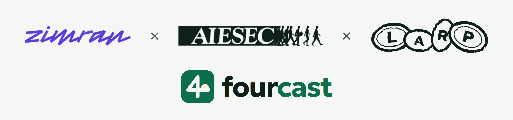
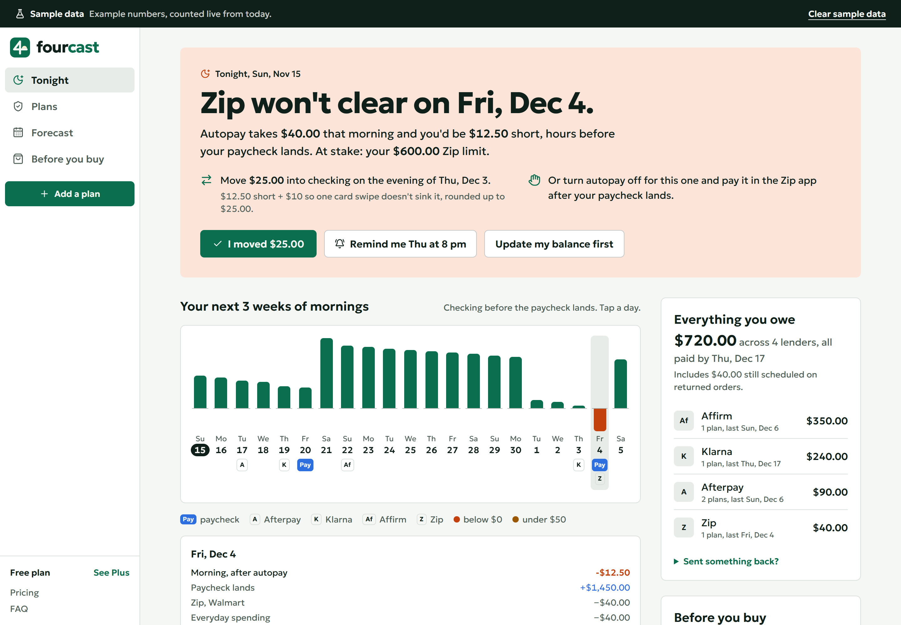

# Fourcast

<p align="center"></p>

**Know tonight if tomorrow's pay-later payment will clear, and what to do if it won't.**

[Live app](https://fourcast-zimran.vercel.app) · [Deck (PDF)](pitch/Fourcast-pitch-deck.pdf) · [Demo inputs](demo_inputs.md) · [Tests](lib/plan.test.ts)

[](https://github.com/karimbeksultan/fourcast/actions/workflows/ci.yml)



Autopay for Klarna, Afterpay, Affirm and Zip runs in the morning; the paycheck lands in the afternoon. One payment that bounces for a few hours can cut a spending limit from $1,000 to $200. Each lender's app only sees its own plans. Fourcast puts all of them next to your paycheck, finds the payments that won't make it, and tells you the night before what to do: *"Move $25 into checking tonight, or pay it by hand after your paycheck lands."*

No sign-up, no bank link; your plans are saved only in your browser. Built for Business Cup 2.0 (AIESEC NU × Zimran), track **Money**, for adults in the US aged 25–45.

## Check it yourself in 2 minutes
1. **Sample data.** Open the [live app](https://fourcast-zimran.vercel.app) → **Try it with sample data**. Tonight says **"Zip won't clear on Fri, Dec 4"**: $12.50 short that morning, **Move $25.00** the evening before. Plans, Forecast and Before you buy give the same answer. (Dates are counted from today; these are the dates when opened on Nov 15, 2026.)
2. **Your own numbers.** **Start over**, then in **Plans** enter: balance **$215**; paycheck **$1,180 every 2 weeks, next in 5 days**; rent **$700 on the 1st**; everyday spending **$175 a week**; plans **Klarna $45 × 3, next in 3 days** and **Afterpay $62.50 × 2, next on payday**. Tonight: **"Afterpay won't clear"** on payday morning, **$17.50 short**, **Move $30.00**. By hand:
   - $215 − 5 days × $25 everyday spending − Klarna $45 = **$45** at the end of the day before payday;
   - payday morning, before the paycheck lands: $45 − Afterpay $62.50 = **−$17.50**;
   - to move: $17.50 + $10, rounded up to the next $5 = **$30.00**.

   The same case is a golden test in [`lib/plan.test.ts`](lib/plan.test.ts) ("README: check it yourself").
3. **Why you come back.** Open `/?due=<date of the risky payment>` (for the sample: `/?due=2026-12-04`): the evening check-in asks what's in checking now and re-checks tomorrow morning. It is free. With **Plus**, a calendar file (`.ics`) puts this link in an 8 pm reminder the night before every payment.
4. **Payments.** In **Before you buy**, check a price that doesn't fit → **Start free trial** → Stripe test checkout with card `4242 4242 4242 4242`, any future date, any CVC. No real money moves. Back in the app, Plus shows **Payday Sync**: the day to buy so every payment lands the morning after a payday.

More texts to paste into "Add a plan" (a 36-month Affirm plan, a non-BNPL text) and every expected number are in [`demo_inputs.md`](demo_inputs.md).

## What it does
| Screen | What you get |
|---|---|
| **Tonight** (`/tonight`) | One sentence about the next payment that won't clear and the one thing to do the evening before; three weeks of *morning* balances (after autopay, before the paycheck); a **returns tracker** (sent back → store refunded → lender credited) with a **dispute letter** when it stalls; what you owe per lender. |
| **Plans** (`/plans`) | Your plans and your money, the inputs. Add a plan by pasting text, a screenshot or four fields. Each plan shows **"2 of 4 paid"** and its payment history; **Payments** lists what's coming up and what's already paid across lenders. |
| **Forecast** (`/timeline`) | Your next 6 weeks as a calendar: paydays, rent, every plan payment, the lowest point. With Plus, download the dates to your calendar (`.ics`) with an 8 pm reminder the night before each payment. |
| **Before you buy** (`/check`) | Whether a new Pay in 4 fits, which payment it would make fail, and **Payday Sync**: the day to buy so every payment lands the morning after a payday. |

The app screens share one frame (`components/app-shell.tsx`): a sidebar with the four screens on desktop, tabs on tablets, a bottom bar on phones, and a bar on top whenever you're looking at **sample data**.

**Free:** Tonight, all plans, returns and dispute letters, the forecast, the evening check-in, "fits / not right now". **Plus** ($29.99 a year or $4.99 a month, free until your second payday): the night-before reminders (calendar file), Payday Sync and the first day it fits, the exact shortfall. Payments run in **Stripe test mode**; no real money moves.

## How it works
- **The math is plain code, not AI.** `lib/plan.ts` simulates 42 days from your balance, paychecks, rent, everyday spending and every plan. Every screen uses one *morning model*: each payment is checked against yesterday's end-of-day balance minus that morning's debits, before the paycheck (`debitRisks`, `dayLow`), so Tonight, Plans, Forecast and Before you buy give the same answer. The evening check-in (`applyCheckIn`) takes what's in checking now and never counts today's debits twice. Payment history (`planHistory`) is inferred from each plan, because there is no bank link. Every demo number is a golden test in `lib/plan.test.ts`; the rules and expected numbers are in [`demo_inputs.md`](demo_inputs.md).
- **AI does two small jobs, always with a fallback.** It reads a pasted confirmation or a screenshot into a plan (`/api/read-plan`; without it you type four fields), and it can polish a dispute letter (`/api/dispute`; the template always works, and the AI draft is used only if it keeps every fact). Models: Gemini Flash-Lite via Google AI Studio; when one model's free quota runs out (429) the next takes over at once, and Gemma 4 31B is the slow last resort.
- **No accounts, no bank link.** State lives in `localStorage` with a versioned zod schema. The server stores nothing; keys stay on the server. Two things leave the browser, only when you ask: the text or screenshot you want read into a plan, and your notes for a dispute letter, go to Google's Gemini models. The footer and the FAQ say so.
- **Plus is a test-mode paywall, unlocked in this browser.** After Stripe Checkout (test mode only; live keys are refused), `/api/checkout/confirm` asks Stripe whether the subscription is live, and the browser then turns Plus on in `localStorage`.
- **Guard rails:** the AI and checkout routes allow 30 requests a minute per IP (`lib/rate-limit.ts`, 429 with `Retry-After`), so nobody can burn the free model quota; the dispute letter waits at most 8 s for the AI, then the template answers; every response carries basic security headers (`next.config.ts`).

## Known limits
- **The debit time is an assumption.** Lenders don't publish when autopay runs, so Fourcast assumes the worst case: in the morning, before the paycheck lands. If your paycheck arrives early (for example, early direct deposit), it is more cautious than it needs to be.
- **Plus lives in this browser.** There are no accounts, so the browser keeps the Stripe checkout session id: `/api/checkout/confirm` asks Stripe whether that subscription is still live, and `/api/checkout/cancel` cancels it in Stripe. With accounts, a Stripe webhook would own the entitlement.
- **The rate limit is shared only with Redis.** With Upstash Redis configured (`UPSTASH_REDIS_REST_URL`, `UPSTASH_REDIS_REST_TOKEN`) every server instance shares one count per minute; without it each instance counts in memory.
- **Calendar reminders depend on the calendar app.** Each payment in the `.ics` file carries its own 8 pm reminder. We have not tested every app: Google Calendar may ignore reminders inside an imported file and use your default notifications instead.
- **The forecast is only as good as the numbers you type.** There is no bank link: the balance, paycheck and plans are entered by hand, and the payment history is inferred from each plan.

## Run it
```bash
npm install
npm run dev      # http://localhost:3000
npm test         # 50 golden tests: the demo numbers, the morning model, check-in, payment history, AI fallbacks, rate limit, edge cases
npm run build
npm run test:e2e   # the demo path in a real browser (phone and desktop), against the live site or E2E_URL
npm run eval:read -- https://fourcast-zimran.vercel.app   # 4 real AI calls: does AI read the plans right, and how fast
```
Everything works without keys: reading screenshots falls back to manual entry, dispute letters use the template, and the paywall uses a demo checkout. To turn them on, copy `.env.example` to `.env` and add a free Google AI Studio key (`LLM_1_API_KEY`, `LLM_2_API_KEY`), optionally an OpenRouter key as a third provider (`LLM_3_API_KEY`), and a Stripe **test** key (`STRIPE_SECRET_KEY=sk_test_…`; live keys are refused).

## Deploy
Vercel with its GitHub integration: every push to `main` is a production deploy. Keys live in Vercel → Settings → Environment Variables. After each deploy: `npm run smoke -- https://fourcast-zimran.vercel.app` (all pages, security headers, `/api/health`, and both APIs, with no AI call). Rollback: Vercel → Deployments → Instant Rollback.

## Evidence and decisions
- [`research/README.md`](research/README.md): **every number on the slides** with its source, the exact quote, and whether it is verified or an assumption.
- [`research/bnpl-pain/REPORT.md`](research/bnpl-pain/REPORT.md) (in Russian) and [`complaints.csv`](research/bnpl-pain/complaints.csv): 128 sourced complaints and the Federal Reserve numbers (26% of pay-later users paid late, 11% had a payment set off an overdraft or NSF fee).
- [`research/reviews.md`](research/reviews.md): 2,000 recent US App Store reviews of Klarna, Afterpay, Affirm and Zip; the payment-side complaints were read by hand.
- [`research/search-demand.md`](research/search-demand.md): people already search "why did klarna lower my limit" and "klarna payment failed but money in bank" (Google US autocomplete), the organic channel.
- [`research/benchmarks.md`](research/benchmarks.md): RevenueCat, Adapty and Adjust 2026 numbers behind the price and the growth plan.
- [`CONCEPT.md`](CONCEPT.md): why Tonight is the home screen. [`LIMIT_GUARD.md`](LIMIT_GUARD.md): the morning-model spec. [`docs/case-compliance.md`](docs/case-compliance.md): the product checked against the case and the organizers' FAQ. [`BRIEF.md`](BRIEF.md) → "Решения": the decision log (in Russian).

## Key dependencies
Next.js 16, React 19, TypeScript, Tailwind CSS 4, shadcn/ui, zod, Vitest. AI: Google AI Studio (Gemini Flash-Lite, Gemma 4 as the last resort), optional OpenRouter. Payments: Stripe test mode. Hosting: Vercel.

*Not financial advice.*
